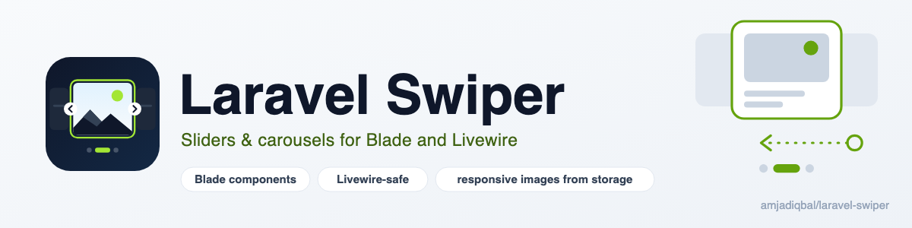
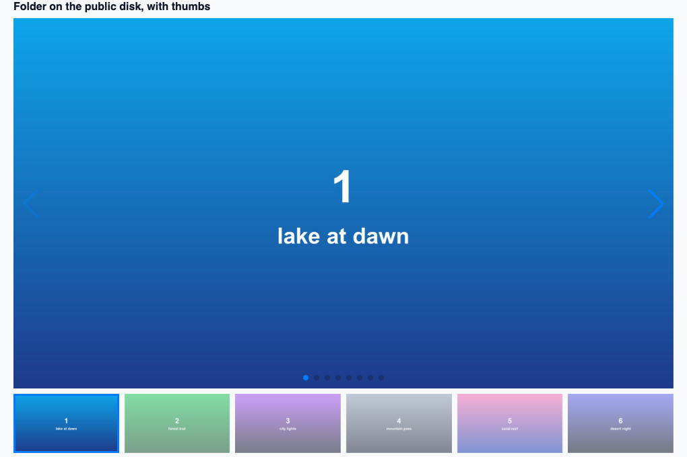

<p align="center">
  <picture>
    <source media="(prefers-color-scheme: dark)" srcset="art/banner-dark.png">
    
  </picture>
</p>

# Laravel Swiper: sliders and carousels for Blade and Livewire

[Swiper](https://swiperjs.com) sliders, carousels and image galleries for Laravel as Blade components.
Navigation, pagination, thumbs, autoplay, effects and lazy loading are typed props. The carousels keep
working through Livewire updates and `wire:navigate`. Slides can come from an Eloquent collection, Spatie
Media Library or a folder on a storage disk (public or, with signed URLs, private), as lazy images with
`sizes` worked out for you and a `srcset` from Spatie or your image resizer. Keyboard and screen-reader
support is on by default. No JavaScript to write, no npm build step.

[](https://packagist.org/packages/amjadiqbal/laravel-swiper)
[](https://packagist.org/packages/amjadiqbal/laravel-swiper)
[](LICENSE.md)

**Docs and demo:** [amjad.com.pk/laravel/packages/laravel-swiper](https://amjad.com.pk/laravel/packages/laravel-swiper)

<p align="center">
  
</p>

```blade
{{-- Every image in storage/app/public/gallery, with a thumbnail strip --}}
<x-swiper folder="gallery" disk="public" thumbs />

{{-- Your products, three per row on desktop, captions and links included --}}
<x-swiper :images="$products" image-field="photo_path" alt-field="name" caption-field="tagline"
          link-field="url" :slides-per-view="1" :breakpoints="[768 => 2, 1024 => 3]" :space-between="16" />

{{-- Any markup you like --}}
<x-swiper loop :autoplay="5000" label="Customer stories">
    @foreach ($stories as $story)
        <x-swiper.slide><x-story-card :story="$story" /></x-swiper.slide>
    @endforeach
</x-swiper>
```

## Why this package

Dropping Swiper into a Laravel app takes ten minutes. The problems start later:

- **Livewire breaks it.** A Livewire update morphs Swiper's markup back to the server HTML. Arrows double
  up, the slide jumps back to the start, or the carousel just stops responding. After `wire:navigate` it
  never starts at all. This package rebuilds a carousel only when its content changed and keeps it on the
  same slide. An unrelated update (a counter elsewhere in the component) leaves it exactly as it was.
- **Images come from storage, not a hard-coded array.** Pass a collection of models, Spatie Media items or
  a disk folder (local, S3, public or private) and get `` tags with `sizes` worked out from your
  breakpoints, `loading="lazy"`, a fixed aspect ratio (no layout shift) and a high fetch priority on the
  first slide. Spatie items bring their own `srcset`; for other images, point the package at your image
  resizer once (see [Responsive srcset](#responsive-srcset)).
- **Accessibility is easy to get wrong.** Every carousel is a labelled region with real `<button>`
  arrows and translated screen-reader messages. Autoplay gets a pause button and stops while focus is
  inside. It also respects `prefers-reduced-motion`. Arrow keys move only the carousel you are using,
  not every carousel on the page as Swiper's own keyboard module does.

## Installation

```bash
composer require amjadiqbal/laravel-swiper
```

That's it: the first `<x-swiper>` on a page prints Swiper 14.3.0 from jsDelivr (with Subresource
Integrity hashes) and a small runtime. With Livewire, also put `@swiperAssets` in your layout's `<head>`:

```blade
<head>
    ...
    @swiperAssets
</head>
```

Requires PHP 8.3+ and Laravel 12 or 13. Livewire 3 or 4 is optional.

## Slides

```blade
<x-swiper id="team" label="Our team" :slides-per-view="1" :breakpoints="[640 => 2, 1024 => 4]" :space-between="24">
    @foreach ($team as $person)
        <x-swiper.slide :label="$person->name">
            <x-swiper.image :src="$person->photo_path" disk="s3" :alt="$person->name" aspect="1/1" />
            <h3>{{ $person->name }}</h3>
        </x-swiper.slide>
    @endforeach
</x-swiper>
```

`<x-swiper.slide>` is a `swiper-slide` div that passes through any attribute (`class`, `style`, `wire:key`).
`<x-swiper.image>` is a responsive, lazy ``: `src` (a path on `disk`, or a URL), `alt`, `srcset`,
`sizes`, `width`, `height`, `aspect`, `fit` (`cover`/`contain`), `lazy` and `priority`.

## Image carousels

`:images` takes any iterable: paths, URLs, arrays, objects, Eloquent models or Spatie Media items.

```blade
<x-swiper :images="['banners/a.jpg', 'banners/b.jpg']" disk="public" />

<x-swiper :images="$post->getMedia('gallery')" conversion="large" thumbs />

<x-swiper :images="$products"
          image-field="cover.path"
          :alt-field="fn ($p) => $p->name.' in '.$p->colour"
          caption-field="tagline"
          link-field="url" />
```

- **Fields.** Without `image-field` it tries `image`, `src`, `url`, `path`, `photo` and `cover`. Alt text
  comes from `alt`, `title` or `name`. Captions come from `caption`, links from `href` or `link`. Each
  `*-field` accepts dot notation or a closure. Arrays can also carry `srcset`, `width` and `height`.
- **Spatie Media Library** items (or a model attribute that returns one) use their own URL and responsive
  `srcset`. Alt text: a named `alt-field` if you pass one, else the media's `alt` custom property, else the
  model's `alt`, `title` or `name`, else the media's name.
- **Links** from `link-field` are only rendered when they are `http(s)`, `mailto`, `tel` or relative URLs;
  anything else (such as `javascript:`) is dropped, so user-supplied links are safe to pass.
- **Folders.** `folder="gallery" disk="s3"` lists every image file directly in that folder, in natural
  order (`img2` before `img10`). Alt text comes from the file name: `01-harbour-at-noon.jpg` becomes
  "Harbour at noon". Pass `:alt-field="fn ($path) => ..."` to set your own. Set
  `swiper.images.folder_cache` to cache the listing.
- **`thumbs`** renders a linked thumbnail strip under the carousel. To link a strip you built yourself,
  use `thumbs="my-thumbs-id"` and give that strip `is-thumbs`.
- **Lazy loading.** The first image loads eagerly with `fetchpriority="high"`. The rest get
  `loading="lazy"` and Swiper's preloader. `:lazy="false"` loads them all eagerly.

### Private disks and buckets

By default image URLs come from the disk's `url()`, which only works for public files. For a private disk
or bucket, turn on signed URLs from `temporaryUrl()`:

```php
// config/swiper.php
'images' => [
    'temporary_urls' => ['s3-private' => 60],   // minutes per disk, or one number for every disk
],
```

A Livewire update that doesn't change a carousel keeps the URLs it already has, so pick a lifetime longer
than a typical visit. Local private disks need `'serve' => true` in `config/filesystems.php` to issue
temporary URLs.

### Responsive `srcset`

Out of the box only Spatie Media items (and arrays that carry their own `srcset`) get a `srcset`: Laravel
stores one file per image, so the other widths need something that resizes. Point the package at it
once:

```php
// config/swiper.php: an image CDN or resizer (imgix, Cloudinary, Cloudflare Images, Bunny, Glide...)
'images' => [
    'srcset_url' => '{url}?w={width}&fm=webp',
    'widths' => [480, 800, 1200, 1600, 2000],
],
```

Or build the URLs in code, for example in `AppServiceProvider::boot()`:

```php
use AmjadIqbal\LaravelSwiper\Facades\Swiper;
use AmjadIqbal\LaravelSwiper\Support\Image;

Swiper::srcsetUsing(fn (Image $image, int $width) => route('img', ['w' => $width, 'path' => $image->path]));
```

With signed URLs, build the srcset with `Swiper::srcsetUsing()` (a query string appended to a signed URL
breaks its signature). `sizes` is worked out from `slides-per-view` and `breakpoints`. For example,
`:breakpoints="[768 => 2]"` gives `(min-width: 768px) 50vw, 100vw`. Pass `sizes` to override it. SVGs
never get a srcset.

## Options

| Prop | Default | |
|---|---|---|
| `id` | from the content | Needed for `thumbs`, events and `swiper:go`. |
| `label` | "Carousel" | Accessible name of the region. |
| `slides-per-view` | `1` | A number or `"auto"`. |
| `space-between` | `0` | Pixels between slides. |
| `breakpoints` | `[]` | `[640 => 2, 1024 => 3]` (slides per view), or full Swiper breakpoint arrays. |
| `loop` / `rewind` | `false` | Endless loop, or jump back to the start after the last slide. |
| `speed` | `300` | Transition in ms. |
| `direction` | `horizontal` | Or `vertical` (give the carousel a height). |
| `effect` | `slide` | `fade`, `cube`, `coverflow`, `flip`, `creative`, `cards`. |
| `centered` / `auto-height` | `false` | Center the active slide, or resize to the active slide's height. |
| `navigation` | `true` | Previous/next buttons. |
| `pagination` | `true` | `true`/`"bullets"`, `"dynamic"`, `"fraction"`, `"progressbar"` or `false`. |
| `scrollbar` | `false` | A draggable scrollbar. |
| `autoplay` | `false` | `true` (5 s) or a delay in ms. Adds a pause button. |
| `pause-on-hover` | `true` | Pause autoplay under the mouse. |
| `keyboard` | `true` | Arrow keys, Home and End for the carousel in use. |
| `mousewheel` / `free-mode` | `false` | Wheel scrolling, or free scrolling without snapping. |
| `lazy` | `true` | Lazy-load image slides. |
| `thumbs` | `false` | `true` for image carousels, or the id of your own thumbs carousel. |
| `images`, `folder`, `disk`, `image-field`, `alt-field`, `caption-field`, `link-field`, `conversion` | | See [Image carousels](#image-carousels). |
| `aspect` / `fit` / `sizes` | `16/9` / `cover` / auto | For image slides. |
| `options` | `[]` | Any [Swiper parameter](https://swiperjs.com/swiper-api#parameters), applied last. |

Invalid values (`effect="spin"`, `pagination="dots"`) throw an `InvalidArgumentException` naming the
allowed values, so a typo fails in development instead of rendering a broken carousel.

## Livewire and wire:navigate

Nothing to set up. A carousel inside a Livewire component:

- **stays as it is** when an update doesn't change it: same slide, autoplay still running;
- **is rebuilt** when its slides or options change, staying on the same slide where that slide still
  exists. If the visitor paused autoplay, it stays paused;
- **starts again** after `wire:navigate`, with no duplicate scripts. Back and forward buttons restore
  clean pages.

Talk to a carousel from Livewire or Alpine:

```php
$this->dispatch('swiper:go', id: 'gallery', index: 2);   // Livewire
```

```blade
<button @click="$dispatch('swiper:go', { id: 'gallery', index: 0 })">Back to start</button>   {{-- Alpine --}}

<div @swiper:slide-change="current = $event.detail.index">...</div>
```

`swiper:init` and `swiper:slide-change` bubble from the carousel with
`{ id, index, activeIndex, total, swiper }`. From plain JavaScript use `LaravelSwiper.get('gallery')` to
get the Swiper instance, `LaravelSwiper.init(element)` after inserting HTML yourself, and
`LaravelSwiper.destroy(element)`, where `element` is a carousel or any element containing carousels.

## Accessibility

- A `role="region"` landmark with your `label` and `aria-roledescription="carousel"`. Each slide is a
  group labelled "2 of 5" (Swiper's a11y module, with messages from the package translations).
- Arrows are real `<button>`s with labels. Bullets are focusable and labelled "Go to slide 3". A visible
  focus ring is styled for both.
- Autoplay adds a pause/play button (WCAG 2.2.2). It pauses while keyboard focus is inside or the mouse
  is over the carousel. With `prefers-reduced-motion: reduce` there is no autoplay and slides change
  instantly (turn this off with `swiper.reduced_motion`).
- The thumbs strip is hidden from screen readers, because it repeats the main carousel.
- Translate or reword every message:
  `php artisan vendor:publish --tag=swiper-translations`.

## Assets: CDN, local or your own bundle

```dotenv
SWIPER_ASSETS=cdn     # default: jsDelivr, pinned to 14.3.0, with SRI
SWIPER_ASSETS=local   # serve the bundled copy yourself (no third-party request)
SWIPER_ASSETS=none    # you load Swiper (e.g. with Vite); only the runtime is printed
```

For `local`, publish the files once: `php artisan vendor:publish --tag=swiper-assets`. For `none`, put
this in `resources/js/app.js`:

```js
import Swiper from 'swiper/bundle';
import 'swiper/css/bundle';
window.Swiper = Swiper;
```

The runtime loads Swiper asynchronously and only once, picks up a CSP nonce from `Vite::useCspNonce()`,
and moves its tags into `<head>` so a Livewire morph never removes them. Restyle with Swiper's CSS
variables (`--swiper-theme-color`, `--swiper-navigation-size`...) or this package's
`--laravel-swiper-focus`, `--laravel-swiper-control-bg` and `--laravel-swiper-control-fg`.

## Configuration

```bash
php artisan vendor:publish --tag=swiper-config
```

`config/swiper.php` holds the asset URLs and hashes, the default Swiper options for every carousel,
`reduced_motion` and the image settings (`disk`, `srcset_url`, `widths`, `extensions`, `folder_cache`,
`temporary_urls`).
`php artisan about` shows the installed version and asset mode.

## Testing

```bash
composer test
scripts/ci-local.sh   # Pint, PHPStan and Pest on PHP 8.3-8.5 x Laravel 12 and 13
```

## Need this built into your app, or something custom?

I build Laravel storefronts, galleries, admin panels and packages for teams. If you'd rather have your
product pages, media library or landing pages designed and wired up for you, or need something this
package doesn't do,
[get in touch](https://amjad.com.pk/contact?utm_source=github&utm_medium=readme&utm_campaign=laravel-swiper).

## Support

- 🐛 **Bug or feature request**: [open an issue](https://github.com/amjadiqbal/laravel-swiper/issues)
- 🔒 **Security issue**: please report privately via GitHub's security tab

## Need this customised, or something built?

I'm available for custom development, package integration, and technical consulting.

[](https://www.upwork.com/freelancers/amjadkhatri)

## More packages

Part of a family of open-source packages. See [all of them](https://github.com/amjadiqbal?tab=repositories).

| | |
|---|---|
| [laravel-driver-js](https://github.com/amjadiqbal/laravel-driver-js) | Driver.js product tours and onboarding for Laravel |
| [kiln](https://github.com/amjadiqbal/kiln) | Deploy-time OPcache control for Laravel |
| [laravel-tiptap](https://github.com/amjadiqbal/laravel-tiptap) | Tiptap editor for Laravel |
| [laravel-logpulse](https://github.com/amjadiqbal/laravel-logpulse) | Log health monitoring and alerting |

## Credits

- [Swiper](https://github.com/nolimits4web/swiper) by Vladimir Kharlampidi (MIT), which does all the
  sliding in the browser. Its 14.3.0 bundle ships in `resources/dist` under its own licence. This package
  is an independent wrapper and is not affiliated with Swiper.
- [Amjad Iqbal](https://amjad.com.pk)

## License

MIT. See [LICENSE.md](LICENSE.md).
